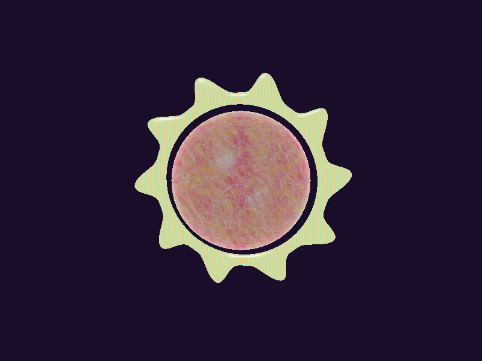
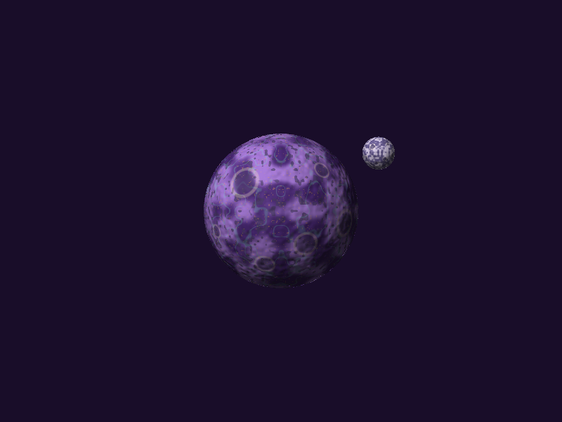
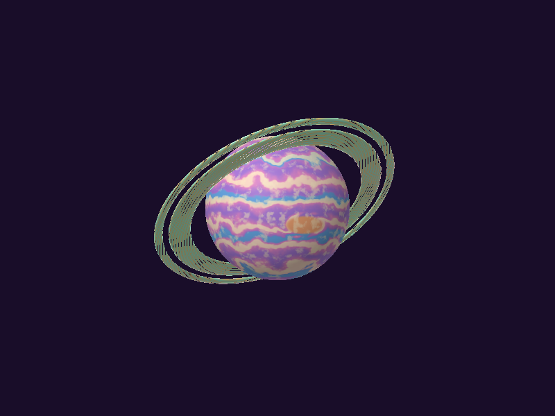
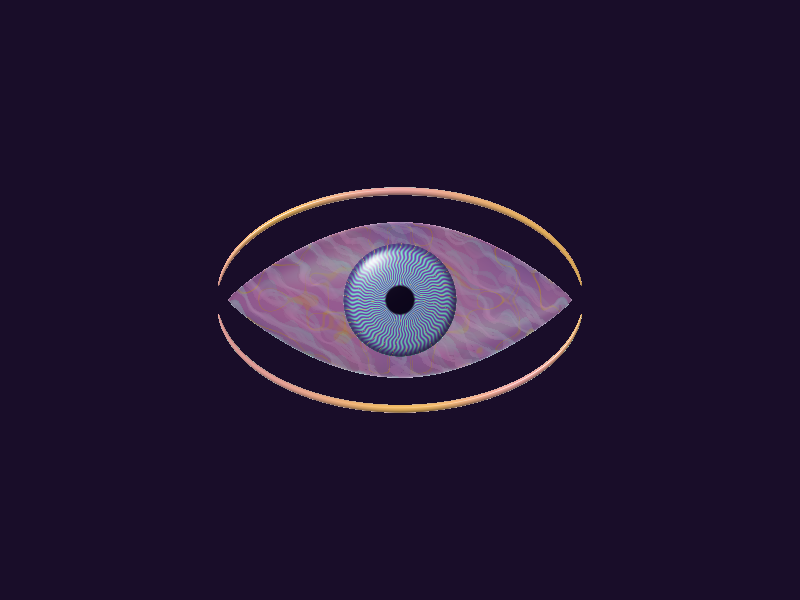
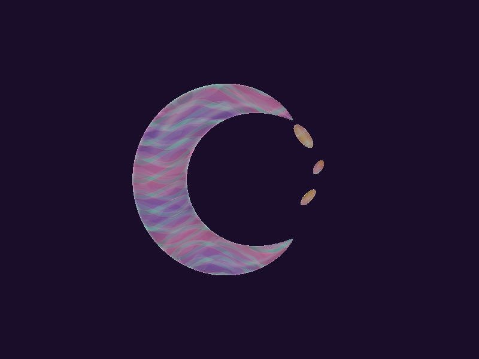
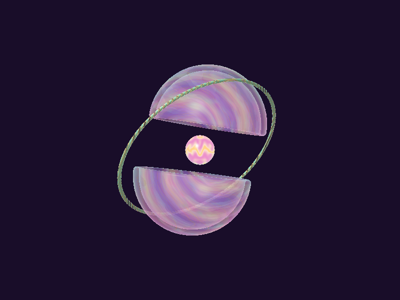
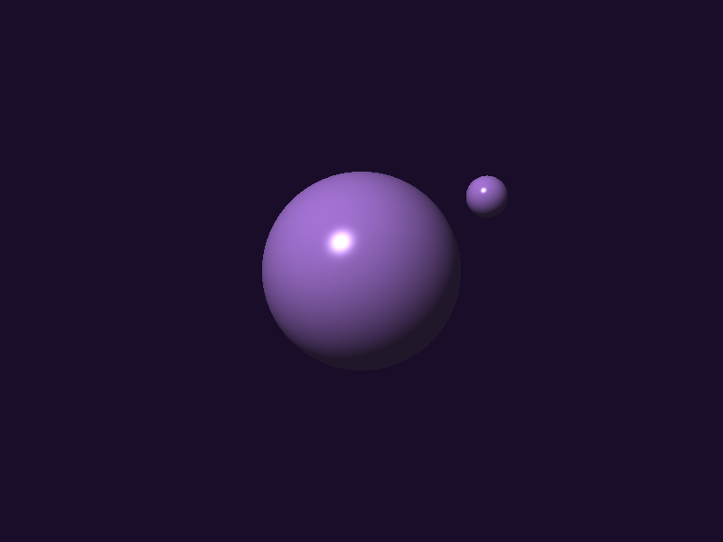
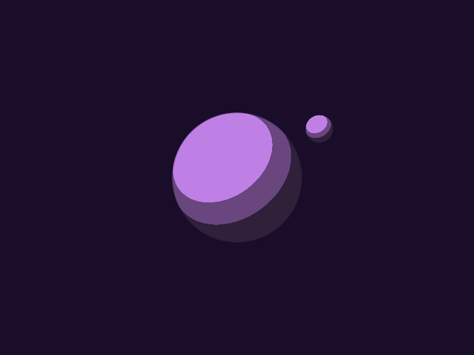
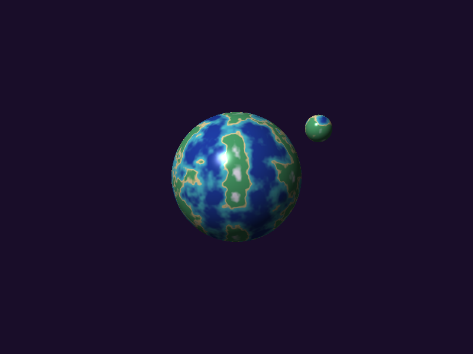
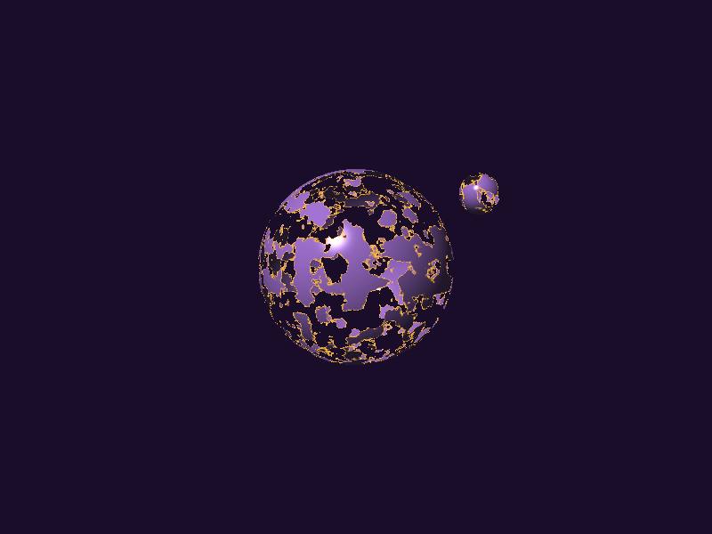

# Lab 5 — Shaders de cuerpos celestes

Software renderer en Rust y CPU con minifb. Dibuja tres cuerpos esféricos
obligatorios (estrella, planeta rocoso y gigante gaseoso) y tres diseños extra.
Todos los colores, patrones, ruido, iluminación y efectos se calculan mediante
shaders procedurales: el visor no carga texturas ni materiales MTL.

[Repositorio del laboratorio](https://github.com/MagicBag-tab/Lab_5_Shaders)

## Ejecutar

Instalar Rust estable con soporte de la edición 2024. Desde la raíz:

```powershell
cargo run --release
```

El binario predeterminado es `lab_6_carga_de_modelo`, nombre heredado de la base.
Blender y Python no son necesarios para ejecutar el visor: los OBJ ya se incluyen.

## Capturas reales del renderer

Imágenes de 800 × 600 obtenidas del framebuffer CPU, con los mismos shaders y
rasterizador que usa la ventana. Vista frontal en tiempo cero, sin postprocesado.
No son renders de Blender ni imágenes conceptuales.

### Solaria — estrella esférica



### Lunaria — planeta rocoso esférico y luna



### Aurelia — gigante gaseoso esférico con anillos



### Ocularis — planeta extra con forma de ojo



### Labyrinthia — planeta extra con forma de creciente



### Vórtex — planeta extra dividido



Ocularis, Labyrinthia y Vórtex cuentan como los tres planetas extra del
laboratorio, según la confirmación recibida. Los tres cuerpos obligatorios
utilizan geometría esférica. La captura de Lunaria muestra su luna separada y
la de Aurelia muestra los anillos pasando delante y detrás del planeta.

### Comparación de técnicas de sombreado

Capturas de Lunaria con la misma vista frontal y luz. Los modos `F2`–`F7`
permiten comparar las técnicas de la presentación sobre la misma geometría.

| Flat (`F2`): luz por cara | Gouraud (`F3`): luz por vértice |
|---|---|
|  |  |

| Phong (`F4`): luz por fragmento | Toon (`F5`): bandas de iluminación |
|---|---|
|  |  |

| Terreno fBm (`F6`): océano y continentes | Disolución (`F7`): descarte por ruido |
|---|---|
|  |  |

La disolución se captura con umbral 0.5. Estos modos sustituyen el acabado
artístico para mostrar cada técnica por separado.

## Controles

| Tecla | Acción |
|---|---|
| `1`–`6` | Solaria, Lunaria, Aurelia, Ocularis, Labyrinthia y Vórtex |
| `F1` | Acabados artísticos propios de cada cuerpo |
| `F2` / `F3` / `F4` | Flat / Gouraud / Phong |
| `F5` / `F6` / `F7` | Toon / terreno fBm / disolución |
| `S` | Activar/desactivar shaders; sólido blanco para inspeccionar geometría |
| `T` | Alternar sólido y wireframe |
| `G` | Giro general (apagado al iniciar para distinguir los accesorios) |
| `A` | Pausar/reanudar accesorios |
| `ESPACIO` | Pausar/reanudar todas las animaciones |
| `R` | Vista frontal y giro general apagado |
| Flechas | Rotar la vista |
| `-` / `=` | Disminuir/aumentar el umbral de disolución |
| `P` | Normal → grises → inversión → bordes Sobel |
| `ESC` | Salir |

Seleccionar `F1`–`F7` activa shaders y sale de wireframe. El título muestra los
estados del visor. `F2`–`F7` son modos de comparación aplicables a los seis diseños.

## Capas de color de los shaders artísticos

Cada fila enumera aportes que modifican el color; no cuenta los accesorios como
capas del cuerpo principal.

| Cuerpo | Capas identificables |
|---|---|
| Solaria | 1. Base durazno. 2. Regiones coral con ruido de baja frecuencia. 3. Células doradas. 4. Filamentos crema. 5. Reflejos y borde nacarado. |
| Lunaria | 1. Base lavanda. 2. Regiones minerales violetas. 3. Cráteres con cuencas oscuras y bordes claros. 4. Vetas menta. 5. Destellos dorados discretos. |
| Aurelia | 1. Base lavanda. 2. Bandas rosa. 3. Bandas azul/crema. 4. Turbulencia fBm que deforma las bandas. 5. Tormenta ovalada con remolinos. 6. Nubes claras. |
| Ocularis | 1. Base lavanda. 2. Regiones rosa. 3. Vetas doradas. 4. Variaciones crema. 5. Reflejos y filamentos internos. |
| Labyrinthia | 1. Base lavanda/rosa. 2. Caminos menta. 3. Contornos crema. 4. Líneas doradas. 5. Patrones internos y reflejos. |
| Vórtex | 1. Base lavanda. 2. Remolinos rosa. 3. Regiones crema. 4. Filamentos dorados. 5. Matices menta y acabado de vidrio. |

La luna tiene un shader propio de minerales y cráteres. El iris combina menta,
filamentos violetas, vetas oro, borde oscuro y pupila. Los arcos y la corona
mezclan oro, rosa y crema. Los fragmentos tienen acabado nacarado y el núcleo
de Vórtex usa ondas luminosas. Los anillos usan franjas radiales y huecos por
descarte de fragmentos; el Z-buffer resuelve su paso delante y detrás de Aurelia.

## Modelos y archivos separados

Los archivos usados por el programa están en `assets/models/`:

| Diseño | Archivos OBJ independientes |
|---|---|
| Solaria | `solaria_esfera.obj`, `solaria_corona.obj` |
| Lunaria | `lunaria_planeta.obj`, `lunaria_luna.obj` |
| Aurelia | `aurelia_planeta.obj`, `aurelia_anillo_interior.obj`, `aurelia_anillo_exterior.obj` |
| Ocularis | `ocularis_cuerpo.obj`, `ocularis_iris.obj`, `ocularis_arco_superior.obj`, `ocularis_arco_inferior.obj` |
| Labyrinthia | `labyrinthia_creciente.obj`, `labyrinthia_fragmento_1.obj`, `labyrinthia_fragmento_2.obj`, `labyrinthia_fragmento_3.obj` |
| Vórtex | `vortex_cascaron_superior.obj`, `vortex_cascaron_inferior.obj`, `vortex_nucleo.obj`, `vortex_anillo.obj` |

Son 19 mallas trianguladas con posiciones y normales. Los accesorios conservan
sus coordenadas de montaje; no necesitan desplazamientos extra al cargarlos.
Los OBJ activos no contienen `mtllib` ni `usemtl`. El visor solo necesita las
piezas separadas de `assets/models/`; no depende de los OBJ combinados,
los archivos Blender ni la nave antigua. Las pruebas de rotación usan Lunaria.
El generador antiguo `generate_models` tampoco se usa para estas mallas finales.

## Renderizado y movimiento

`src/triangle.rs` carga la geometría y sus grupos, recorta el plano cercano y
rasteriza en CPU. Interpola posiciones y normales con corrección de perspectiva.
El ruido es determinista y las posiciones locales mantienen los patrones
adheridos al modelo. No se usan backface culling ni mapas de ruido almacenados.

`src/shaders.rs` calcula los acabados artísticos. Lunaria usa bump mapping por
diferencias finitas del ruido, iluminación mate y brillo tenue. Es relieve
aparente: no modifica la silueta. Aurelia conserva normales suaves y nubes fBm.
Solaria tiene una base emisiva que no depende del sombreado difuso de un planeta.

El vidrio combina especular blanco y borde Fresnel con transparencia alfa real.
Se dibujan primero las piezas opacas y después se componen las transparentes con
weighted blended OIT: prueban el Z-buffer opaco, pero no escriben en él. Cinco
muestras de un campo procedural local simulan detalles atrapados en el interior.
El espesor y la composición son aproximaciones artísticas: no hay refracción ni
absorción física, ni intersección exacta con el volumen de cada forma.

`src/techniques.rs` implementa Flat por cara, Gouraud por vértice y Phong por
fragmento, además de Toon, terreno con cuatro octavas de fBm, descarte y
postprocesado. No se implementan texturas, mipmaps ni desplazamiento de vértices.

`src/motion.rs` mueve independientemente la corona, la luna, los anillos, los
fragmentos y el núcleo. Las normales reciben la misma rotación que su pieza.
Las velocidades usan tiempo transcurrido y el encuadre incluye la trayectoria
de los accesorios. Ocularis conserva la alineación de iris y arcos.

## Regenerar capturas y verificar

```powershell
cargo fmt --check
cargo check
cargo test
cargo run --release -- --capture-techniques
```

La captura del framebuffer no necesita abrir una ventana. Para convertir todas
las capturas BMP a PNG desde PowerShell en Windows:

```powershell
Add-Type -AssemblyName System.Drawing
Get-ChildItem assets/previews -Filter *.bmp | ForEach-Object {
    $frame = [System.Drawing.Image]::FromFile($_.FullName)
    try {
        $frame.Save([System.IO.Path]::ChangeExtension($_.FullName, '.png'), [System.Drawing.Imaging.ImageFormat]::Png)
    } finally { $frame.Dispose() }
}
```

La conversión solo cambia el formato, sin agregar efectos ni alterar el diseño.
Para capturar accesorios en otro instante: `cargo run --release -- --capture --time=8`.
Para los siete modos de los seis diseños: `cargo run --release -- --capture-techniques`.
Las capturas reemplazan los archivos del mismo nombre.

Las pruebas cubren carga de los seis diseños, normales, geometría separada sin
MTL, profundidad en perspectiva, recorte, degenerados, descarte, composición de
vidrio, variación de color y conservación del encuadre durante la animación.
